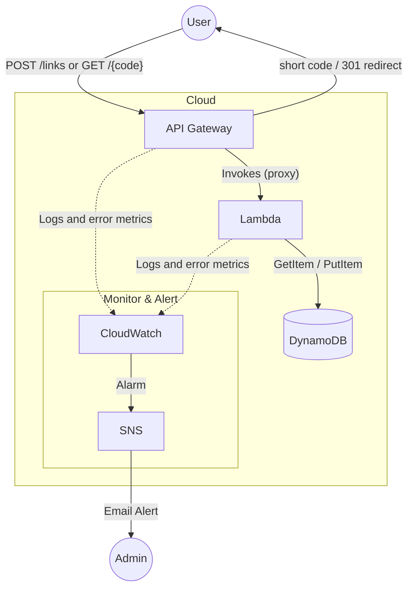

# AWS Serverless URL Shortener

A serverless URL shortener built on AWS (API Gateway + Lambda + DynamoDB), fully managed with Terraform and deployed through a GitHub Actions pipeline that tests, lints, and security-scans every change before it reaches production.

I built this to practice the things a real cloud team cares about: infrastructure as code, least-privilege IAM, CI/CD with quality gates, and monitoring that actually tells me when something breaks.

## Architecture



**How a request flows:**

- **Shortening a link:** `POST /links` with a URL → API Gateway hands the request to Lambda → Lambda generates a random 6-character code and saves it to DynamoDB → the code comes back to the user.
- **Using a short link:** `GET /{code}` → Lambda looks up the code in DynamoDB → API Gateway returns a `301` redirect to the original URL (or a `404` if the code doesn't exist).
- **Monitoring:** API Gateway access logs and Lambda logs/metrics go to CloudWatch. If the Lambda errors or the API returns 5xx errors, an alarm fires and SNS emails me.

## Tech Stack

| Category | Tools |
|---|---|
| **Infrastructure as Code** | Terraform (modules, S3 remote state with native locking) |
| **Compute & Data** | AWS Lambda (Python 3.13), API Gateway (HTTP API), DynamoDB |
| **CI/CD** | GitHub Actions, OIDC (no stored AWS keys) |
| **Quality & Security** | pytest, TFLint, Checkov, `terraform fmt` / `validate` |
| **Monitoring** | CloudWatch (alarms, access logs), SNS, X-Ray |
| **Security** | IAM least privilege, branch protection |

## Design Decisions

### Why serverless?
My last project ([aws-monitored-webserver](https://github.com/BraxtonAndrew/aws-monitored-webserver)) was an EC2 web server. For this one I wanted to learn the other side of AWS: nothing to patch, no server running 24/7, and it costs basically nothing when nobody is using it.

### A separate "bootstrap" for the pipeline's IAM role
The pipeline runs Terraform, so if its own IAM role lived in the same Terraform code, the pipeline could edit its own permissions. One bad PR could grant itself admin. So the role lives in a separate `bootstrap/` folder with its own state, and I apply it by hand. The pipeline can manage the app, but never itself.

### Least-privilege pipeline permissions
My first project's pipeline used `FullAccess` policies. This time each service is scoped to only this project's resources (e.g., only tables named `url-shortener-*`). The IAM permissions specifically only cover the Lambda's role, not the pipeline's own role. A few CloudWatch Logs actions have to be `*` because AWS doesn't support scoping them, and I documented why in the policy.

### OIDC instead of AWS access keys
GitHub Actions authenticates to AWS with short-lived OIDC tokens, so there are no long-lived keys sitting in GitHub secrets. The trust policy is locked to my exact GitHub owner and repo **IDs**, not just names, so a look-alike account can't assume the role.

### Why modules?
Having everything in one `main.tf` was getting pretty messy, with everything hardcoded in one place. I split it into four modules (`dynamodb`, `lambda`, `api`, `monitoring`) that pass values to each other through inputs and outputs. It's a small project, but if I ever want to expand it, modules reduce technical debt and make it a lot easier to read. I used `moved` blocks so the refactor didn't destroy or recreate anything in AWS.

### 14-day log retention
Checkov recommends keeping logs for a year, but API access logs contain visitors' IP addresses, which count as personal data. I don't need them long-term, so I chose data minimization over long retention.

### Collision-safe short codes
Short codes are random, so two could collide. Instead of checking first and then writing (which has a race condition), the Lambda uses a DynamoDB **conditional write** that only saves if the code doesn't exist yet, and retries with a new code if it does.

## CI/CD Pipeline

Every pull request runs through these checks, in order:

1. **pytest**: unit tests for the Lambda (using mocks, so no AWS needed)
2. **terraform fmt**: formatting check
3. **TFLint**: catches bad practices in Terraform
4. **Checkov**: security scan; any new unhandled finding fails the build
5. **AWS credentials via OIDC**: only after the static checks pass
6. **terraform validate** and **terraform plan**: shows exactly what would change

When a PR is merged to `main`, the same pipeline runs `terraform apply`.

**Branch protection** blocks direct pushes to `main`, and all checks have to pass before a PR can be merged. A `concurrency` group makes sure two applies never run at the same time.

## Security

- **Checkov:** 2 findings fixed (DynamoDB point-in-time recovery, Lambda X-Ray tracing). The rest are skipped with a written justification right in the code. For example:
  - **Customer-managed KMS keys:** data is already encrypted at rest with AWS-managed keys, and the data is public URLs, so it's not worth ~$1/month per key
  - **Lambda in a VPC:** the Lambda only talks to DynamoDB's public endpoint, so a VPC would add NAT Gateway costs with no security benefit
  - **Dead letter queue:** DLQs only apply to async invocations; API Gateway calls Lambda synchronously
- **Rate limiting:** API Gateway throttling (5 req/s, burst 10)
- **Input validation:** bad requests return a `400` instead of crashing the Lambda

**Known limitations** (things I'd fix before calling it production-ready):

- `POST /links` is public, so anyone can create links, including people making phishing redirects. Throttling limits the volume, but a real fix needs an authorizer.
- The pipeline can modify the Lambda's IAM role, so it could theoretically attach a broad policy to it. A permissions boundary would cap that.

## Problems I Hit

**Moved files instead of copying them.** I accidentally moved `providers.tf` and `backend.tf` into `bootstrap/` instead of copying them, and had to figure out why the pipeline wanted to recreate every resource. My laptop's local `.terraform/` cache was hiding the missing backend config, but the pipeline starts from a clean checkout. Thankfully the pipeline runs `terraform plan` before anything gets merged, so I caught it before it tried to create everything a second time.

**OIDC kept failing with "Not authorized."** The trust policy looked right, but GitHub's token `sub` claim included numeric IDs for my account and repo (`repo:BraxtonAndrew@<id>/aws-serverless-url-shortener@<id>:...`). I added a temporary debug step to decode the token and print the exact `sub`, then locked the trust policy to those IDs.

**The API crashed with `JSONDecodeError`.** Testing the Lambda directly worked, but real `curl` requests failed. `curl -d` sends form-encoded data by default, so API Gateway base64-encoded the body before passing it on. I updated the Lambda to decode base64 bodies and return a `400` for bad input instead of crashing.

**Throttle test returned 503s, not 429s.** I sent 30 requests at once expecting API Gateway to throttle them, but got `503`s instead. New AWS accounts have a Lambda concurrency limit of 10, so Lambda's limit kicked in before API Gateway's (which is best-effort). It turned out to be a nice example of defense in depth.

**My email almost ended up in an alarm name.** During the module refactor, I accidentally used `var.alert_email` instead of `var.name_prefix` in an alarm name. The plan showed the alarm being replaced with a `(sensitive value)` name, which tipped me off. It would've put my email address into the CloudWatch alarm name.

## Future Improvements

- **JWT authorizer** on `POST /links` so only authenticated users can create links
- **Permissions boundary** on the pipeline role
- **Separate plan and apply roles:** a read-only role for PR plans, and a write role only usable from `main`
- **Custom domain** with Route 53 + ACM for shorter links
- **Simple web frontend** (S3 + CloudFront)
- **Click analytics** (would require switching from `301` to `302` redirects, since browsers cache 301s)
- **Pin GitHub Actions to commit SHAs** to protect against supply-chain attacks

## How to Deploy It Yourself

### Prerequisites
- An AWS account and the AWS CLI configured locally
- Terraform `>= 1.11`
- An S3 bucket for Terraform state (update `backend.tf` and `bootstrap/backend.tf`)
- The GitHub OIDC identity provider already created in your AWS account

### Steps
1. **Apply the bootstrap** (creates the pipeline's IAM role):
   ```bash
   cd bootstrap
   terraform init
   terraform apply
   ```
   Update the `sub` condition in `bootstrap/main.tf` to match your own repo first.
2. **Add GitHub secrets** in your repo settings:
   - `AWS_ROLE_ARN`: the role ARN from the bootstrap output
   - `ALERT_EMAIL`: where alarm emails should go
3. **Open a PR.** The pipeline runs all checks and a plan. Merge it to deploy.
4. **Confirm the SNS subscription** email AWS sends you, or alarms won't be delivered.

### Usage
```bash
API=$(terraform output -raw api_url)

# Shorten a link
curl -X POST "$API/links" \
  -H "Content-Type: application/json" \
  -d '{"url": "https://example.com"}'
# → {"short_code": "aB3xY9"}

# Use it
curl -i "$API/aB3xY9"
# → HTTP/2 301, location: https://example.com
```
